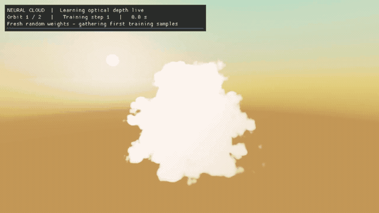

This project is an experiment in **neural network training and inference**. I wanted to explore how neural networks could fit within the tight performance budgets of real-time rendering.

[View the project on GitHub](https://github.com/quentinwarnant/NeuralRaymarchVolumetricCloud).

## Why cloud lighting is expensive

Rendering a volumetric cloud means marching a camera ray through it and sampling its density along the way. At each sample inside the cloud, we also need to work out how much light reaches that point.

That requires **secondary raymarches** towards the sun and upwards towards the sky. These accumulate the cloud density along their paths to estimate *optical depth*: how much cloud material the light passes through. Greater optical depth means more light is absorbed.

## What the network learns

For a static cloud and fixed sun direction, these optical depths stay the same between frames. The network learns to predict both values at points inside the cloud.

The **primary camera ray is still raymarched through the volume**. At each occupied sample, we query the network instead of performing the secondary marches, then use its predictions to calculate the lighting.

The network learns optical depth rather than the final lighting colour. This lets us change the light colour without retraining the model.

## Real-time training

The training targets come from explicit sun and sky-occlusion marches. A separate **multi-bounce path-traced renderer** provides a visual reference.

The project uses **Slang's automatic differentiation** to compute gradients for training directly on the GPU. Training happens in real time, so you can watch the model's predictions improve as the demo runs.

