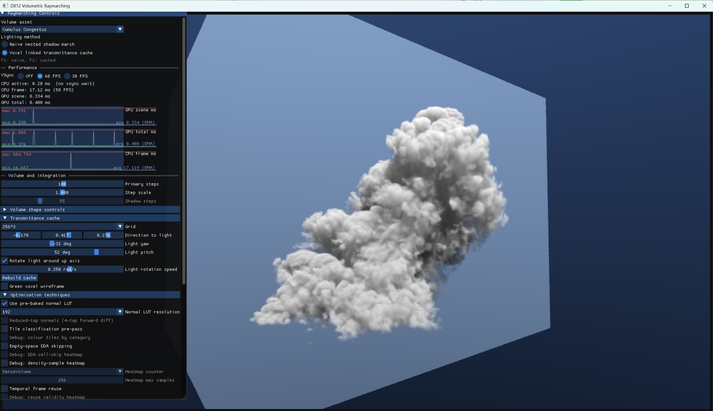
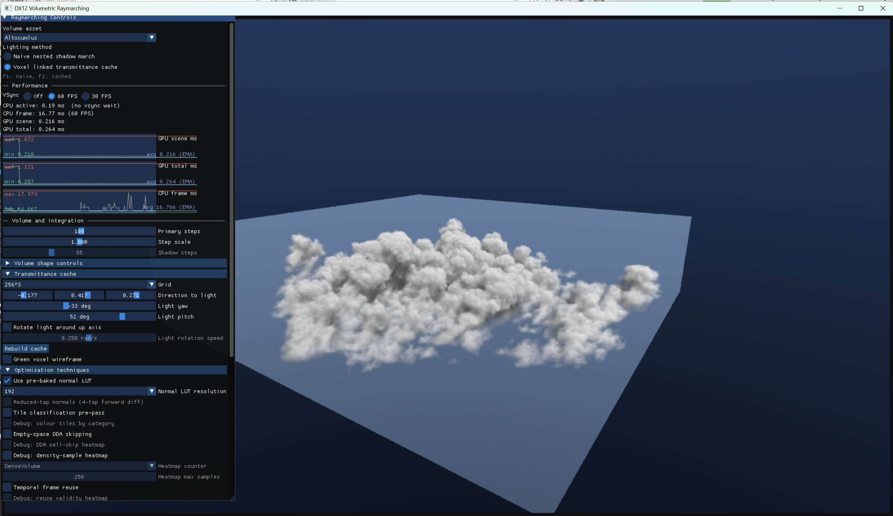
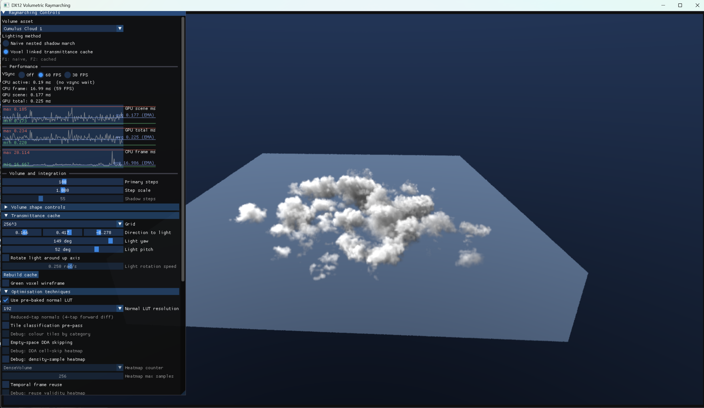

This project is a playground for learning **GPU profiling and optimisation with NVIDIA Nsight Graphics**. It uses a **DirectX 12** volumetric cloud renderer to explore where GPU time goes and measure which changes actually help.

[View the project on GitHub](https://github.com/quentinwarnant/RaymarchingOptimisationExperiments).

## Why cloud lighting is expensive

The renderer loads cloud density from **OpenVDB assets** and marches camera rays through the volume. At each occupied sample, a secondary raymarch towards the light estimates how much cloud material blocks it.

Repeating these **shadow marches** for every sample of every pixel is expensive. For a static cloud and fixed light direction, much of that work is also identical between frames.

## Caching the light paths

The main optimisation idea I had is a **light-aligned 3D cache**. It stores *optical depth*: the accumulated density along the path towards the light. The GPU builds this efficiently by processing columns of the volume in parallel.

When rendering a fresh image, the **primary camera ray is still raymarched through the cloud**. At each sample, a filtered texture lookup replaces the secondary march, and the cached depth determines how much light reaches that point.



The cache can be reused while the cloud and light direction remain unchanged. For rotating light, an optional mode updates it less frequently and blends between cached light directions.

## Reusing unchanged frames

In the standard rendering paths, an optional **static-frame reuse** mode skips raymarching altogether when the camera, lighting and rendering settings are unchanged. It copies the previous rendered image, and each pixel returns before tracing the cloud again.

Camera or lighting changes, a cache rebuild, and certain debug views force a fresh render. Reuse is also disabled during automatic camera orbit or light rotation. This is separate from the 3D lighting cache; the experimental split-trace path does not currently use the same early-out.

## Profiling and results

Other experiments include **empty-space skipping**, precomputed shading normals, and fetching density samples ahead of time to hide texture latency. Not every change helped: reducing sample counts or register usage did not always make the shader faster.

In a fixed-camera benchmark on an **RTX 4090 at 1600 x 900**, the optimised path reduced median raymarch time from **0.670 ms to 0.098 ms**, roughly **6.8 times faster**.

Those timings exclude the UI and cache construction. Building the light cache took around **0.558 ms** separately, so reusing it across frames is important to the benefit.

## Cloud gallery

### Altocumulus

### Cumulus

Click any cloud image to view it at full resolution.